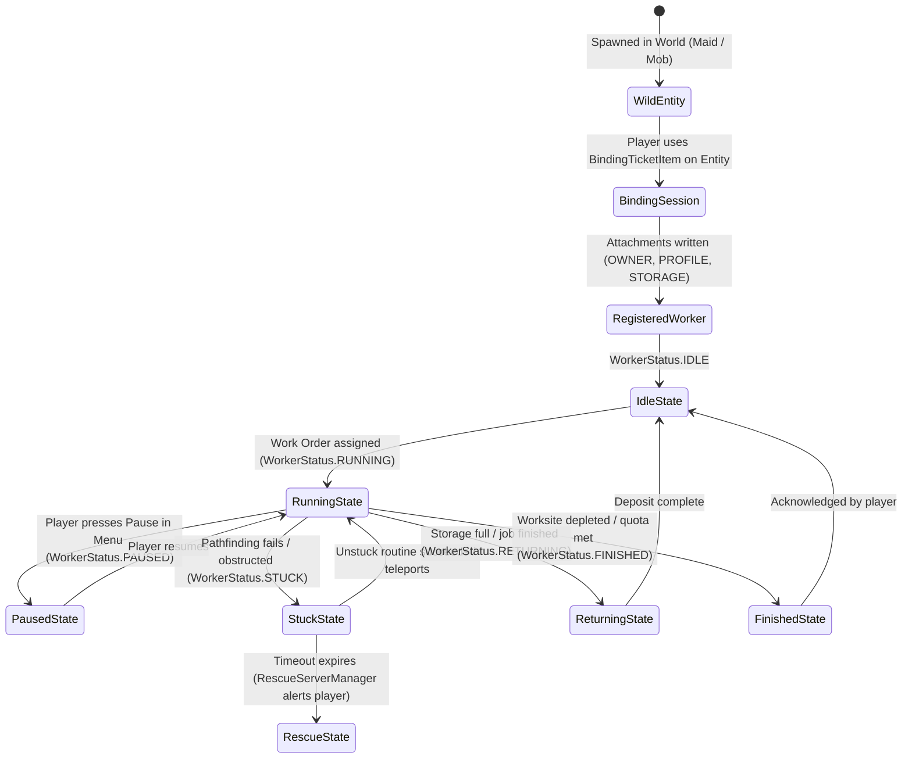
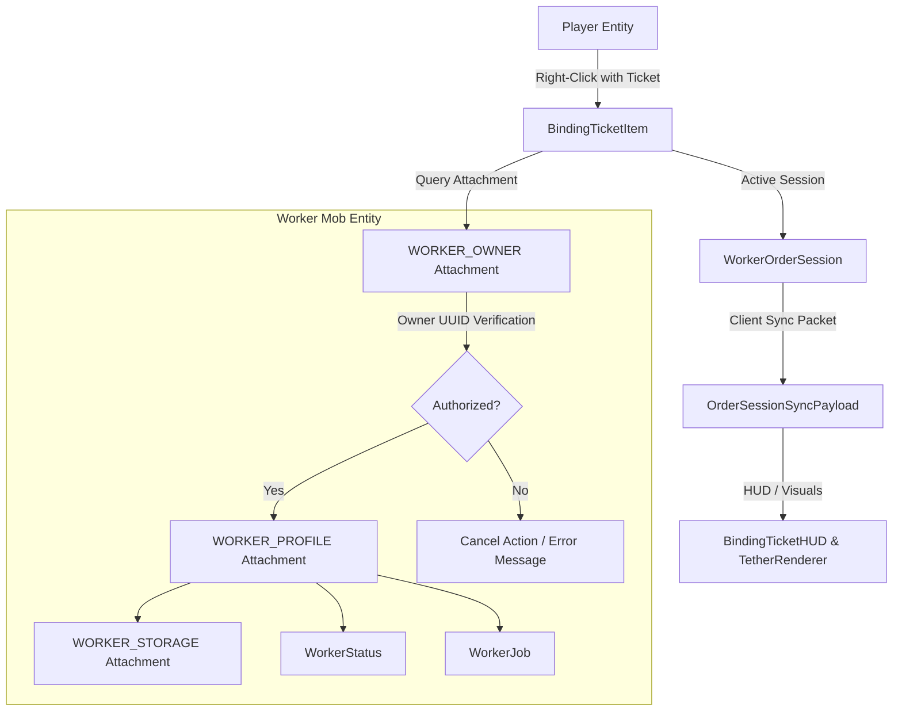
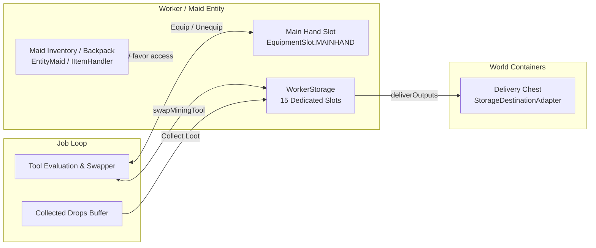
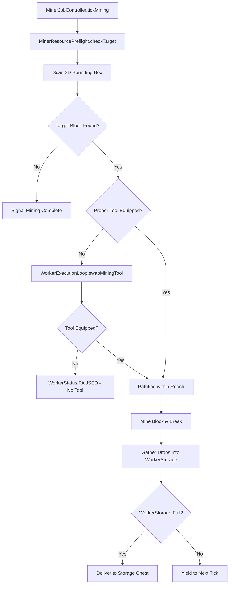
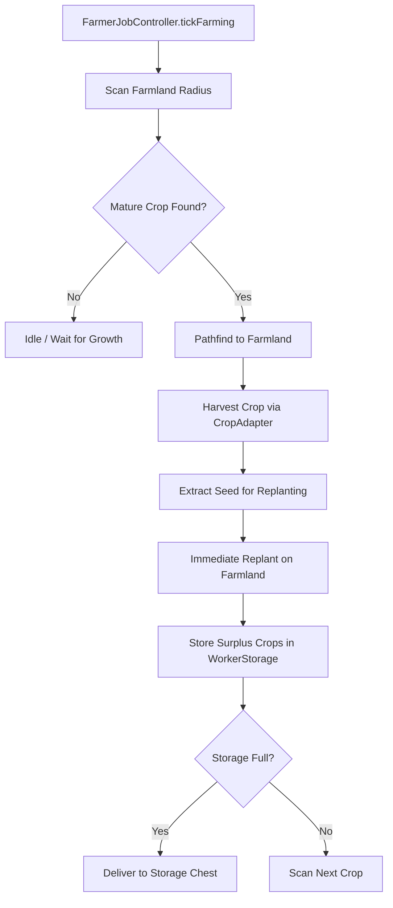
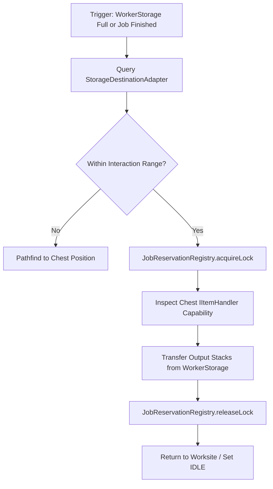
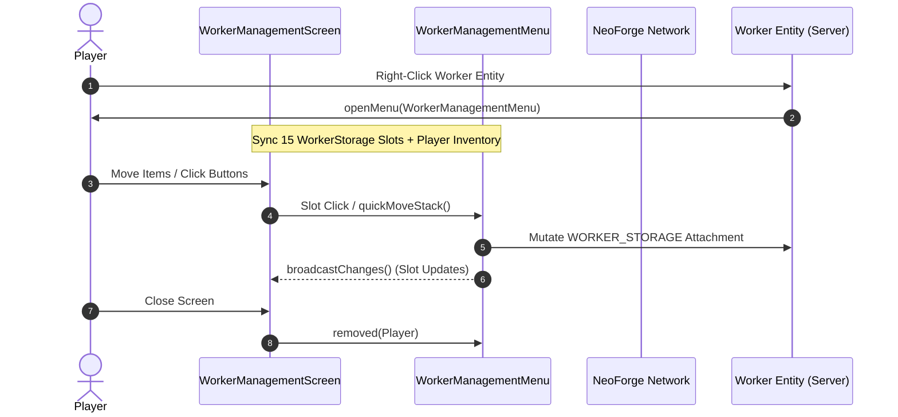

# ELSTAR TICKET — CORE ARCHITECTURE MAPS
**Mod ID:** `elstarticket` | **Environment:** Minecraft 1.21.1 / NeoForge 21.1.264 / TLM 1.5.3  
**Audit Date:** 2026-11-05 | **Mode:** READ-ONLY Structural Intelligence Audit

---

## 1. Map A: Worker Creation and Lifecycle



### Lifecycle Implementation Details
1. **Binding & Initialization (`BindingTicketItem.java`):**
   - Player right-clicks an entity (`EntityMaid` or compatible `Mob`).
   - Checks ownership permissions: if unowned or owned by player, attaches `WORKER_OWNER` with player's UUID.
   - Instantiates and attaches `WORKER_PROFILE` (default `WorkerJob.IDLE`, `WorkerStatus.IDLE`).
   - Instantiates and attaches `WORKER_STORAGE` (fresh 15-slot `WorkerStorage` instance).
2. **Server Tick Pipeline (`WorkerExecutionLoop.java`):**
   - Iterates through all loaded levels in `onServerTick(MinecraftServer)`.
   - Queries entities with `WORKER_PROFILE` attachment.
   - Dispatches entity execution based on current `WorkerJob` and `WorkerStatus`.
3. **Unloading & Serialization:**
   - On chunk unload or world save, NeoForge invokes `serializeNBT()` on `WORKER_PROFILE` and `WORKER_STORAGE`.
   - On chunk reload, attachments are restored from entity NBT via `deserializeNBT()`.

---

## 2. Map B: Worker Identity, Ownership, and Selection



### Identity and Selection Rules
- **Ownership Verification:** Only the player whose UUID matches `WORKER_OWNER` (or server operators) can open the management menu or issue work orders.
- **Session Selection (`WorkerOrderSession`):** A client-side state machine tracks the currently selected worker UUID. The active tether line (`BindingTicketTetherRenderer`) connects player hand to worker entity.
- **Multi-Worker Isolation:** Each worker possesses its own independent `WorkerProfile` and `WorkerStorage` attachment instances on the entity.

---

## 3. Map C: Inventory and Item Management



### Inventory Boundary Matrix
- **Maid Main Hand (`EquipmentSlot.MAINHAND`):** The active tool used by Minecraft AI to break blocks or harvest crops.
- **WorkerStorage (15 slots):** Dedicated container attachment. Holds запасные (reserve) tools, harvest seeds, and mined blocks before delivery.
- **Maid Internal Inventory / Backpack:** Managed by Touhou Little Maid mod. Elstar Ticket primarily operates on `WorkerStorage` to avoid corrupting Maid maid-sugar / favor / bauble slots.
- **Item Reservations (`JobReservationRegistry`):** Prevents cross-worker contention for target chests or specific slot contents during delivery cycles.

---

## 4. Map D: Work Order and Job Lifecycle

```mermaid
sequenceDiagram
    autonumber
    actor Player
    participant UI as WorkOrderScreen / Menu
    participant Session as WorkerOrderSession
    participant Profile as WorkerProfile
    participant Loop as WorkerExecutionLoop
    participant Controller as Miner/Farmer Controller
    
    Player->>UI: Configure Worksite & Storage Pos
    UI->>Session: Commit Work Order
    Session->>Profile: setJob(WorkerJob.MINING)
    Session->>Profile: setStatus(WorkerStatus.RUNNING)
    Note over Loop: Next Server Tick
    Loop->>Profile: Query Active Job
    Loop->>Loop: tryEnsureToolEquippedForJob()
    Loop->>Controller: tickMining() / tickFarming()
    Controller-->>Loop: Step Complete / Needs Delivery
    Loop->>Profile: Update Progress / Status
```

### State Transitions
- **Assignment:** Validated against worksite bounds and destination chest availability via `MinerResourcePreflight`.
- **Execution:** Driven by `WorkerExecutionLoop.processWorker()`. Every 10-20 ticks, controllers re-evaluate target blocks.
- **Pause/Resume:** Player toggles status via `WorkerManagementMenu`. Worker halts pathfinding and retains current tool in Main Hand.
- **Completion/Depletion:** Controller signals completion; worker navigates to storage chest, deposits remaining outputs, resets to `WorkerJob.IDLE`.

---

## 5. Map E: Mining Execution Subsystem



### Critical Mining Invariants
- Mining operates within min/max coordinates configured in `MinerJobData`.
- Preflight evaluates block hardness and harvest level requirement against available tools in `WorkerStorage`.
- Drops are inserted into `WorkerStorage`; if storage is full, state shifts to `WorkerStatus.RETURNING` for deposit.

---

## 6. Map F: Farming Execution Subsystem



### Critical Farming Invariants
- `CropRegistry` and `CropAdapter` define maturity properties for each crop block.
- Replanting is atomic: seed is extracted from harvest drops before surplus is sent to `WorkerStorage`.
- Hoe durability is monitored via `EquipmentCapabilityPolicy`.

---

## 7. Map G: Delivery and Output Storage



### Delivery Guarantees
- Reserve tools (pickaxes, hoes, shears) must be excluded from chest delivery. Only collected resources and surplus items are deposited.
- Destination chest must implement `IItemHandler` (Vanilla chests, modded barrels/crates).

---

## 8. Map H: Menu, Screen, and Network Interaction



---

## 9. Map I: Mod Integration Adapters (TLM & External)

- **Touhou Little Maid (`TouhouLittleMaidCompat.java`):**
  - Uses reflection/interface inspection on `EntityMaid`.
  - Reads maid state without overriding TLM's core task schedule.
- **JourneyMap (`JourneyMapBridge.java`):**
  - Optional client display: registers worker positions as temporary waypoints.
- **Future Integration Hooks:**
  - `StorageDestinationAdapter` already leverages standard NeoForge `Capabilities.ItemHandler.BLOCK`, enabling compatibility with Create item vaults, Refined Storage / AE2 interface chests, and modded storage drawers without hard dependencies.
