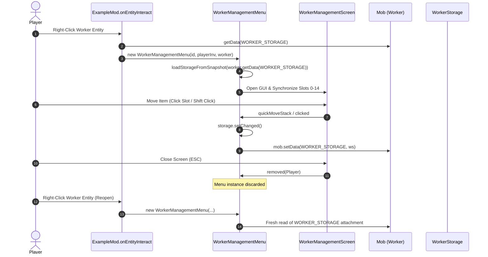

# ELSTAR TICKET — DEPENDENCY & CALL FLOW MAPS
**Mod ID:** `elstarticket` | **Environment:** Minecraft 1.21.1 / NeoForge 21.1.264 / TLM 1.5.3  
**Audit Date:** 2026-11-05 | **Mode:** READ-ONLY Structural Intelligence Audit

---

## 1. Workflow 1: Work Order → Mining Activation → Tool Equip → Execution

```mermaid
sequenceDiagram
    autonumber
    actor Player
    participant Item as BindingTicketItem
    participant Session as WorkerOrderSession
    participant Profile as WorkerProfile
    participant Loop as WorkerExecutionLoop
    participant Swapper as WorkerExecutionLoop.swapJobTool
    participant Storage as WorkerStorage
    participant Entity as Mob (Maid)
    participant Miner as MinerJobController

    Player->>Item: useOn(Entity) / Shift-Right Click
    Item->>Session: commit(Player)
    Session->>Profile: setJob(WorkerJob.MINING)
    Session->>Profile: setStatus(WorkerStatus.RUNNING)
    Note over Loop: ExampleMod.onServerTick (Post)
    Loop->>Loop: processWorker(ServerLevel, Mob, Profile)
    Loop->>Loop: tryEnsureMiningToolEquipped(Mob)
    Loop->>Loop: tryEnsureToolEquippedForJob(Mob, WorkerJobs.MINE)
    Loop->>Entity: getData(ExampleMod.WORKER_STORAGE)
    Entity-->>Loop: WorkerStorage (15 slots)
    Loop->>Swapper: swapJobTool(ws, held, req, reserved, handSetter, storageSetter)
    Note over Swapper: Select best candidate tool in slots 0-14
    Swapper->>Entity: handSetter: setItemSlot(MAINHAND, tool)
    Swapper->>Entity: storageSetter: setData(WORKER_STORAGE, updatedStorage)
    Loop->>Miner: tickMining(Mob, MinerJobData, updatedStorage)
    Miner->>Miner: scanBlock / pathfind / mineBlock
```

---

## 2. Workflow 2: WorkerStorage → Main Hand → Tool Replacement → Restoration

```mermaid
sequenceDiagram
    autonumber
    participant Miner as MinerJobController
    participant Policy as EquipmentCapabilityPolicy
    participant Loop as WorkerExecutionLoop
    participant Swapper as WorkerExecutionLoop.swapJobTool
    participant Storage as WorkerStorage
    participant Entity as Mob (Maid)

    Miner->>Entity: getItemBySlot(MAINHAND)
    Miner->>Policy: isToolSafe(heldTool)
    alt Tool Durability Depleted or Broken
        Policy-->>Miner: false (Unsafe)
        Miner->>Loop: swapMiningTool(Mob, Storage, targetBlockState)
        Loop->>Swapper: swapJobTool(...)
        Note over Swapper: 1. Find fresh candidate pickaxe in slots 0-14<br/>2. Stash damaged tool into empty slot<br/>3. Decrement fresh tool slot
        Swapper->>Entity: setItemSlot(MAINHAND, freshTool)
        Swapper->>Entity: setData(WORKER_STORAGE, updatedStorage)
        Swapper-->>Miner: ToolSwapResult.SUCCESS
    else Tool Still Safe
        Policy-->>Miner: true (Safe)
        Miner->>Miner: Continue mining block
    end
```

---

## 3. Workflow 3: Mining Output → Temporary Buffer → Delivery Chest

```mermaid
sequenceDiagram
    autonumber
    participant Miner as MinerJobController
    participant World as ServerLevel
    participant Data as MinerJobData
    participant Loop as WorkerExecutionLoop
    participant Adapter as StorageDestinationAdapter
    participant Reg as JobReservationRegistry
    participant Chest as IItemHandler / Container

    Miner->>World: destroyBlock(targetPos, dropResources=true)
    Miner->>Data: withPendingDrops(collectedStacks)
    Note over Miner: Storage full or quota met?
    alt Needs Delivery
        Miner->>Loop: Transition to JobStatus.DELIVERING
        Loop->>Adapter: getDestination(profile.storagePos())
        Loop->>World: Pathfind to chestPos
        Loop->>Reg: acquireLock(workerUUID, chestPos)
        Loop->>Miner: deliverToContainer(profile, container) / deliverToStorage
        Miner->>Chest: Insert pending drops (grow/setItem)
        Miner->>Data: withItemsDelivered(count, remaining)
        Loop->>Reg: releaseLock(workerUUID, chestPos)
        Loop->>Miner: Transition to JobStatus.RUNNING / COMPLETED
    end
```

---

## 4. Workflow 4: Menu Open → Interaction → Close → Reopen



---

## 5. Workflow 5: Worker Save → World Unload → World Reload

```mermaid
sequenceDiagram
    autonumber
    participant Level as ServerLevel / LevelChunk
    participant NF as NeoForge Attachment Engine
    participant Entity as Mob (Worker)
    participant Loop as WorkerExecutionLoop

    Note over Level: World Save / Chunk Unload Triggered
    Level->>Entity: serializeNBT()
    Entity->>NF: Query Attached Types
    NF->>Entity: WORKER_PROFILE.serializeNBT() -> CompoundTag
    NF->>Entity: WORKER_STORAGE.serializeNBT() -> CompoundTag (15 slots)
    NF->>Entity: WORKER_OWNER.serializeNBT() -> UUID Tag
    Level->>Level: Write Chunk to Disk
    Level->>Loop: ExampleMod.onChunkUnload(ChunkEvent.Unload)
    Note over Level: Server Restart / Chunk Loaded
    Level->>Entity: deserializeNBT()
    Entity->>NF: Restore Attached Types
    NF->>Entity: WORKER_PROFILE.deserializeNBT(tag)
    NF->>Entity: WORKER_STORAGE.deserializeNBT(tag)
    Note over Loop: Next ExampleMod.onServerTick
    Loop->>Level: Discover loaded entities with WORKER_PROFILE
    Loop->>Loop: Resume processWorker() seamlessly
```
