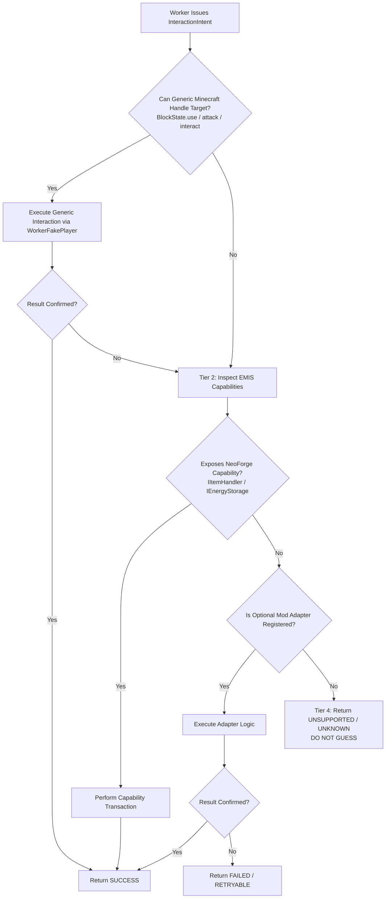

# ELSTAR TICKET — INTERACTION COMPATIBILITY MATRIX
**Mod ID:** `elstarticket` | **Package:** `com.example.examplemod`  
**Environment:** Minecraft 1.21.1 | NeoForge 21.1.264 | Java 21 | TLM 1.5.3  
**Audit Date:** 2026-11-05 | **Mode:** READ-ONLY Architectural Matrix  
**Status Evidence Legend:** `[SOURCE_VERIFIED]`, `[API_CONFIRMED]`, `[PROPOSED]`, `[UNKNOWN]`, `[NOT_IMPLEMENTED]`, `[NOT_RUNTIME_VERIFIED]`

---

## 1. Overview & Evaluation Principles

Under the **Two-Intent Interaction Model (`LEFT_CLICK` / `RIGHT_CLICK`)**, compatibility is evaluated by determining whether a target responds to generic player simulation (`Tier 1`), standard NeoForge capabilities (`Tier 2`), or requires an explicit mod adapter (`Tier 3`).

> [!IMPORTANT]
> A mod is **NOT** marked compatible simply because its jar loads or its blocks exist in the world. Real compatibility requires verified method-level execution and postcondition confirmation.

---

## 2. Interaction Compatibility Assessment Table

| Target Category | Generic Feasibility | Known API / Capability Evidence | Adapter Needed? | Unknowns & Edge Cases | Verification Required |
|---|---|---|---|---|---|
| **Vanilla Blocks** (Doors, levers, buttons, composters, cakes, trapdoors) | **HIGH** `[API_CONFIRMED]` | `BlockState.useWithoutItem` `BlockState.useItemOn` `BlockState.attack` | **NO** | Redstone update delays; door double-click toggle loops. | `[NOT_RUNTIME_VERIFIED]` Verify `WorkerFakePlayer` right-click opens doors without desync. |
| **Vanilla Entities** (Villagers, sheep, cows, horses, allays) | **HIGH** `[API_CONFIRMED]` | `Mob.mobInteract` `LivingEntity.interact` `ItemStack.interactLivingEntity` | **NO** (Optional helper) | Villager opens GUI; worker must suppress GUI opening server-side. | `[NOT_RUNTIME_VERIFIED]` Verify sheep shearing drops wool to worker without crashing. |
| **Containers & Inventories** (Chests, barrels, hoppers, shulkers) | **VERY HIGH** `[API_CONFIRMED]` | NeoForge `Capabilities.ItemHandler.BLOCK` `Container` interface | **NO** | Double-chest compound bounding boxes; locked containers with lock codes. | `[SOURCE_VERIFIED]` StorageDestinationAdapter already validates double-chests. |
| **Generic Modded Tech Blocks** (Modded furnaces, generators, macerators) | **HIGH** `[API_CONFIRMED]` | NeoForge `Capabilities.ItemHandler.BLOCK` `Capabilities.EnergyStorage.BLOCK` `BlockState.useItemOn` | **NO** (Standard) | Modded blocks refusing FakePlayer interaction due to anti-automation checks. | `[NOT_RUNTIME_VERIFIED]` Test modded block response to `WorkerFakePlayer`. |
| **Create Mod** (Cranks, depots, presses, mixers, basins, contraptions) | **MEDIUM** `[PROPOSED]` | Depots/Basins expose `IItemHandler` `[API_CONFIRMED]`. Cranks require continuous right-click hold. | **YES** (For kinetic machines & cranks) | Contraptions exist as moving `AbstractContraptionEntity` rather than world blocks. | `[UNKNOWN]` Feasibility of worker riding or interacting with moving contraptions. |
| **Waystones** (Waystone blocks, sharestones, warp plates) | **LOW-MEDIUM** `[PROPOSED]` | Right-click opens client-only Screen (`WaystoneGUI`). | **YES** (Dedicated Adapter) | Fake players cannot send client GUI packets to select teleportation destinations. | `[NOT_RUNTIME_VERIFIED]` Verify if `IWaystoneManager` allows direct server-side teleport trigger. |
| **Applied Energistics 2 (AE2)** (ME Terminals, ME Chest, ME Interface) | **MEDIUM** `[PROPOSED]` | ME Interface exposes `IItemHandler` `[API_CONFIRMED]`. Terminals require grid connection and client GUI. | **YES** (For terminal queries) **NO** (For ME Interface deposit) | Grid power security cards can block unauthorized fake player access. | `[UNKNOWN]` Whether worker owner security credentials pass through `WorkerFakePlayer`. |
| **Refined Storage** (Grid, Interface, Importers, Exporters) | **MEDIUM** `[PROPOSED]` | RS Interface exposes standard `IItemHandler` `[API_CONFIRMED]`. Grids require client network GUI. | **YES** (For grid extraction) **NO** (For interface deposit) | RS network node state requires active controller power. | `[UNKNOWN]` Behavior when worker attempts to right-click an unpowered grid block. |
| **Multi-block Ritual Structures** (Blood Magic, Astral Sorcery, Occultism) | **MEDIUM** `[PROPOSED]` | Ritual altars/pedestals expose `IItemHandler` or `useItemOn` for catalyst placement. | **YES** (For multi-block validation) | Multi-block master blocks often require specific player blood/soul/tier bindings. | `[UNKNOWN]` Multi-block boundary detection without dedicated mod API dependencies. |
| **Draconic Crafting** (Draconic Evolution Fusion Core & Injectors) | **LOW** `[PROPOSED]` | Custom multiblock state; requires RF charging on injectors + button activation on core. | **YES** (Mandatory Adapter) | Extreme explosion risks if craft fails; craft parameters not exposed via vanilla tags. | `[UNKNOWN]` Stability of executing fusion crafting via automated worker clicks. |

---

## 3. The "Generic First, Adapter When Necessary" Decision Tree

### Invariants for Adapter Authors
1. **No Compulsory Mod Dependencies `[PROPOSED]`:** Adapters must be registered conditionally using soft reflection or NeoForge mod-presence checks (`ModList.get().isLoaded(...)`).
2. **Fail-Closed Default `[PROPOSED]`:** If an adapter cannot confirm whether an action succeeded, it must return `UNKNOWN` or `UNSUPPORTED`. It must **never** forge a `SUCCESS` outcome.
3. **No Direct World Overrides `[PROPOSED]`:** Adapters must not bypass permissions or claim locks established by the `JobSafetyPolicy`.
