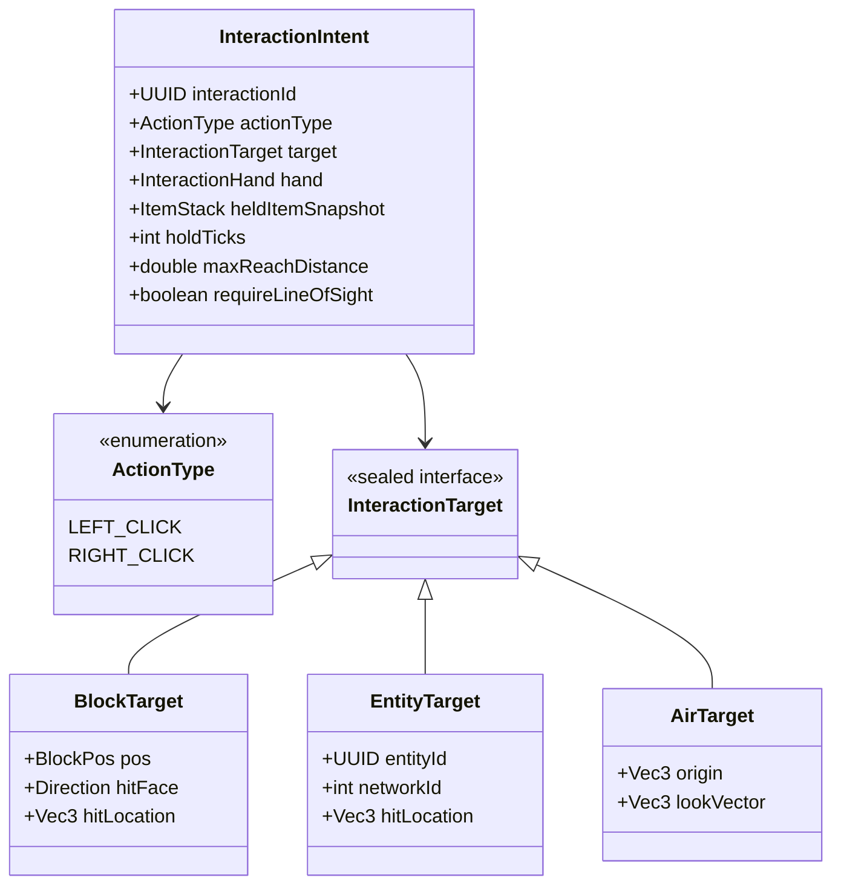
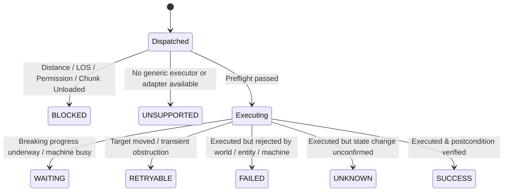

# ELSTAR TICKET — INTERACTION SYSTEM SPECIFICATION
**Mod ID:** `elstarticket` | **Package:** `com.example.examplemod`  
**Environment:** Minecraft 1.21.1 | NeoForge 21.1.264 | Java 21 | TLM 1.5.3  
**Audit Date:** 2026-11-05 | **Mode:** READ-ONLY Architecture Specification  
**Status Evidence Legend:** `[SOURCE_VERIFIED]`, `[API_CONFIRMED]`, `[PROPOSED]`, `[UNKNOWN]`, `[NOT_IMPLEMENTED]`, `[NOT_RUNTIME_VERIFIED]`

---

## 1. Architectural Philosophy: The Two-Intent Model

To avoid writing bespoke code for every individual modded machine, crop, or block, all physical worker interactions are unified into **exactly two primary interaction primitives**:

```
                  ┌───────────────────────────────┐
                  │       Worker / Job Plan       │
                  │   (Mining, Farming, Chores)   │
                  └──────────────┬────────────────┘
                                 │ Issues Intent
                                 ▼
                    ┌─────────────────────────┐
                    │    InteractionIntent    │
                    │  LEFT_CLICK | RIGHT_CLICK│
                    └────────────┬────────────┘
                                 │
     ┌───────────────────────────┴───────────────────────────┐
     ▼                                                       ▼
┌──────────────┐                                       ┌───────────────┐
│  LEFT_CLICK  │                                       │  RIGHT_CLICK  │
│  Semantics:  │                                       │  Semantics:   │
│ - Attack     │                                       │ - Activate    │
│ - Mine/Break │                                       │ - Use Item    │
│ - Punch/Hit  │                                       │ - Open GUI    │
└──────────────┘                                       └───────────────┘
```

### Core Invariants
1. **Semantic Decoupling `[PROPOSED]`:**
   - `LEFT_CLICK` does **not** strictly mean "destroy block". It means "perform a primary strike/punch/dig action on the target".
   - `RIGHT_CLICK` does **not** strictly mean "open GUI". It means "perform a secondary use/activate/interact action on the target with held item".
2. **Intent Independence `[PROPOSED]`:**
   - Higher-level job planners (`MinerJobController`, `FarmerJobController`) never destroy blocks or insert items directly. They issue an `InteractionIntent` and react to the standardized `InteractionResult`.

---

## 2. InteractionIntent Data Structure



### 2.1 Specification of Fields
- `UUID interactionId`: Globally unique transaction ID for idempotency, logging, and crash reconciliation.
- `ActionType actionType`: Enum: `LEFT_CLICK` or `RIGHT_CLICK`.
- `InteractionTarget target`: Sealed hierarchy:
  - `BlockTarget(BlockPos pos, Direction hitFace, Vec3 hitLocation)`
  - `EntityTarget(UUID entityId, int networkId, Vec3 hitLocation)`
  - `AirTarget(Vec3 origin, Vec3 lookVector)` (e.g. eating, drinking, firing bow)
- `InteractionHand hand`: `MAIN_HAND` or `OFF_HAND`.
- `ItemStack heldItemSnapshot`: An immutable copy of the tool or item in hand when the intent was issued (protects against concurrent inventory mutation).
- `int holdTicks`: Number of ticks the click is maintained (1 for instantaneous click; >1 for progressive block breaking or drawing a bow).
- `double maxReachDistance`: Reach threshold (default: 4.5 blocks eye-to-target).
- `boolean requireLineOfSight`: Raytrace obstruction validation flag.

---

## 3. Standardized Execution Result Model

The execution result must cleanly separate actions that failed before execution from those that executed with or without effect.



### Detailed Result Statuses
1. `SUCCESS`: Action executed and postcondition verified (e.g. block broken, crop harvested, machine state changed).
2. `FAILED`: Action executed cleanly through Minecraft/mod APIs, but returned `InteractionResult.FAIL` or false (e.g. chest locked, machine unpowered).
3. `BLOCKED`: Action could not be attempted because prerequisites were unmet (out of reach, line of sight obstructed, chunk unloaded, owner permission denied).
4. `WAITING`: Intent is actively progressing over multiple ticks (e.g. breaking a hard block with break progress `0.0 < progress < 1.0`).
5. `UNSUPPORTED`: No generic mechanism or registered adapter knows how to safely execute the intent on this specific target.
6. `UNKNOWN`: Action executed, but neither vanilla nor mod APIs exposed a verifiable confirmation of success.
7. `RETRYABLE`: Transient failure (target entity path drifted slightly; worker should re-align and retry next tick).

---

## 4. The 4-Tier Hybrid Execution Pipeline

When an `InteractionIntent` is submitted to the `InteractionResolver`, it resolves execution through 4 hierarchical tiers:

```
[InteractionIntent]
        │
        ▼
┌────────────────────────────────────────────────────────┐
│ Tier 1: Generic Minecraft Interaction                  │
│ - BlockState.useItemOn / useWithoutItem                │
│ - ItemStack.useOn / use                                │
│ - Player.attack / Mob.mobInteract                      │
│ - ServerPlayerGameMode.destroyBlock                    │
└───────────────────────┬────────────────────────────────┘
                        │ (If Tier 1 is unhandled or special case)
                        ▼
┌────────────────────────────────────────────────────────┐
│ Tier 2: EMIS Capability Discovery                      │
│ - Inspect NeoForge Capabilities (IItemHandler, etc.)   │
│ - Inspect Block/Item Tags (mineable, hoes, wrenches)   │
│ - Inspect BlockState Properties (open, lit, age)       │
└───────────────────────┬────────────────────────────────┘
                        │ (If special mod mechanics required)
                        ▼
┌────────────────────────────────────────────────────────┐
│ Tier 3: Optional Mod Adapters (Pluggable)              │
│ - Create kinetic machine adapter                       │
│ - Waystones activation adapter                         │
│ - AE2 / Refined Storage terminal adapter               │
└───────────────────────┬────────────────────────────────┘
                        │ (If no safe path exists)
                        ▼
┌────────────────────────────────────────────────────────┐
│ Tier 4: Explicit Fallback (Fail-Closed)                │
│ - Return UNSUPPORTED or UNKNOWN                        │
│ - Never guess or destroy arbitrarily                   │
└────────────────────────────────────────────────────────┘
```

---

## 5. Simulated Player Architecture (`WorkerFakePlayer`)

`[PROPOSED]`

Because Minecraft 1.21.1 interaction methods require a `Player` or `ServerPlayer` instance (e.g. `BlockState.useItemOn(ItemStack, Level, Player, InteractionHand, BlockHitResult)`):
- Workers (which are `Mob` instances) cannot invoke vanilla interaction pipelines directly.
- **Solution:** A managed `WorkerFakePlayer` extending NeoForge's `net.neoforged.neoforge.common.util.FakePlayer`.

### Rules for `WorkerFakePlayer`
1. **Identity & Ownership:**
   - The fake player's profile must reference the worker's owner UUID: `new GameProfile(workerProfile.workerId(), "[ElstarWorker]" + worker.getName().getString())`.
   - Security mods (FTB Chunks, Claims) will evaluate the worker against the owner's team permissions.
2. **Context Synchronization:**
   - Before executing an intent, `WorkerFakePlayer` is positioned at the worker's exact coordinates, rotation, and eye level.
   - `WorkerFakePlayer.setItemInHand(hand, worker.getItemBySlot(handSlot))`.
   - After execution, any item damage, consumption, or returned stacks on the fake player are copied back to the worker's `MAINHAND` or `WorkerStorage`.
3. **World Protection:**
   - `WorkerFakePlayer` is never spawned as a persistent world entity; it exists purely in memory on the logical server thread.

---

## 6. Timing, Debounce, and Anti-Looping Controls

To prevent infinite rapid-click loops and server tick lag:
1. **Debounce Interval:**
   - Discrete `RIGHT_CLICK` interactions have a mandatory 4-tick cooldown before another right-click intent can be issued on the same target.
2. **Progressive Block Breaking (`LEFT_CLICK`):**
   - For blocks with hardness > 0, breaking is not instant.
   - The resolver calculates break speed per tick:
     $$\Delta \text{progress} = \frac{\text{destroySpeed}(\text{heldTool}, \text{blockState})}{30 \times \text{hardness}}$$
   - Emits block break progress packets (`level.destroyBlockProgress(entityId, pos, stage)`) to nearby clients so breaking animations and sounds render naturally.
   - Yields `WAITING` until progress reaches 1.0.
3. **Repeated Failure Limit:**
   - If an intent returns `FAILED` or `UNSUPPORTED` 3 consecutive times on the same target, the intent is placed in a 60-tick lockout, preventing CPU thrashing.
