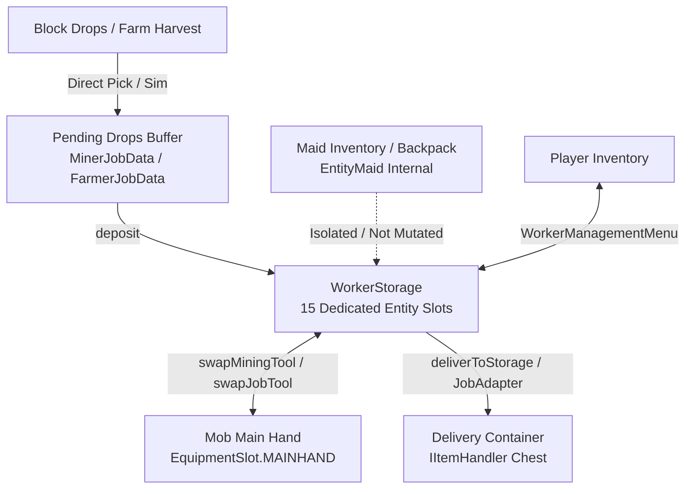

# ELSTAR TICKET — ITEM LIFECYCLE & INVENTORY MUTATION AUDIT
**Mod ID:** `elstarticket` | **Environment:** Minecraft 1.21.1 / NeoForge 21.1.264 / TLM 1.5.3  
**Audit Date:** 2026-11-05 | **Mode:** READ-ONLY Structural Intelligence Audit

---

## 1. Item Lifecycle & Boundary Flow

Items in Elstar Ticket exist across five distinct boundary zones:



### Boundary Definitions
1. **Mob Main Hand (`EquipmentSlot.MAINHAND`):** Active tool used by vanilla mob AI for block breaking or farming. Holds exactly 1 `ItemStack`.
2. **WorkerStorage (`ExampleMod.WORKER_STORAGE`):** 15-slot container attached to the `Mob` entity. Serves as reserve tool rack, seed reserve, and collected loot buffer.
3. **Pending Drops (`MinerJobData.pendingStacks()`, `FarmerJobData.pendingStacks()`):** Ephemeral in-memory/NBT list tracking broken block drops awaiting deposit into WorkerStorage or chest.
4. **Delivery Chest:** External block entity implementing `IItemHandler` or `Container` at the worksite's configured storage coordinate.
5. **Maid Backpack (`EntityMaid`):** Independent inventory belonging to Touhou Little Maid. Mod logic avoids mutating Maid backpack slots directly to protect custom baubles, maid-sugar, and equipment.

---

## 2. Comprehensive Inventory Mutation Audit Table

| Operation | Source File | Method | Target Inventory / Field | Mutation Type | Caller |
|---|---|---|---|---|---|
| `slotStack.grow(inserted)` | `FarmerJobController.java:238` | `deliverToStorage` | `slots` (Chest/Container list) | `grow` (stack merge) | Delivery loop |
| `toInsert.shrink(inserted)` | `FarmerJobController.java:239` | `deliverToStorage` | `toInsert` (pending item) | `shrink` (decrement) | Delivery loop |
| `toInsert.shrink(inserted)` | `FarmerJobController.java:255` | `deliverToStorage` | `toInsert` (pending item) | `shrink` (new slot placement) | Delivery loop |
| `container.setItem(i, ...)` | `FarmerJobController.java:299` | `deliverToContainer` | `Container` (Live block entity) | `setItem` (overwrite slot) | Farm delivery cycle |
| `drop.shrink(1)` | `FarmerJobController.java:567` | `executeHarvestStep` | `mutableDrops` (fresh loot) | `shrink` (seed reservation) | Farm harvest |
| `slotStack.shrink(1)` | `FarmerJobController.java:585` | `executeHarvestStep` | `WorkerStorage` slot | `shrink` (seed consumption) | Farm harvest |
| `setData(WORKER_STORAGE)` | `FarmerJobController.java:587` | `executeHarvestStep` | `Mob` Entity Attachment | `setData` (attachment replace) | Farm harvest |
| `grown.grow(1)` | `FarmerJobController.java:681` | `refundToStorage` | `WorkerStorage` slot | `grow` (seed refund) | Farm harvest error |
| `grown.grow(1)` | `FarmerJobController.java:692` | `refundToStorage` | `WorkerStorage` slot | `grow` (seed refund) | Farm harvest error |
| `setData(WORKER_STORAGE)` | `FarmerJobController.java:716` | `refundToWorkerStorage` | `Mob` Entity Attachment | `setData` (attachment replace) | Farm harvest error |
| `setData(WORKER_STORAGE)` | `JobAdapter.java:149` | `GenericDepositAdapter.execute`| `Mob` Entity Attachment | `setData` (attachment replace) | Job queue step deposit |
| `container.setItem(i, ...)` | `JobAdapter.java:162` | `insertIntoContainer` | `Container` (destination) | `setItem` (slot placement) | Job queue step deposit |
| `existing.grow(transfer)` | `JobAdapter.java:169` | `insertIntoContainer` | `Container` slot | `grow` (merge) | Job queue step deposit |
| `toInsert.shrink(transfer)` | `JobAdapter.java:170` | `insertIntoContainer` | `toInsert` stack | `shrink` (decrement) | Job queue step deposit |
| `extractItem(...)` | `JobAdapter.java:212` | `GenericWithdrawAdapter.execute`| `IItemHandler` (source chest) | `extractItem` (capability extraction) | Job queue step withdraw |
| `inSlot.split(needed)` | `JobAdapter.java:224` | `GenericWithdrawAdapter.execute`| `Container` slot | `split` (container extraction) | Job queue step withdraw |
| `setData(WORKER_STORAGE)` | `JobAdapter.java:252` | `addWorkerItem` | `Mob` Entity Attachment | `setData` (attachment replace) | Job queue step withdraw |
| `existing.grow(transfer)` | `JobAdapter.java:257` | `addWorkerItem` | `WorkerStorage` slot | `grow` (merge) | Job queue step withdraw |
| `stack.shrink(transfer)` | `JobAdapter.java:258` | `addWorkerItem` | Input stack | `shrink` (decrement) | Job queue step withdraw |
| `setData(WORKER_STORAGE)` | `JobAdapter.java:260` | `addWorkerItem` | `Mob` Entity Attachment | `setData` (attachment replace) | Job queue step withdraw |
| `setData(WORKER_STORAGE)` | `JobAdapter.java:265` | `addWorkerItem` | `Mob` Entity Attachment | `setData` (attachment replace) | Job queue step withdraw |
| `slotStack.grow(inserted)` | `MinerJobController.java:1138` | `deliverToStorage` | `containerSlots` list | `grow` (merge) | Miner delivery loop |
| `toInsert.shrink(inserted)` | `MinerJobController.java:1139` | `deliverToStorage` | `toInsert` (pending drop) | `shrink` (decrement) | Miner delivery loop |
| `toInsert.shrink(inserted)` | `MinerJobController.java:1155` | `deliverToStorage` | `toInsert` (pending drop) | `shrink` (new slot placement) | Miner delivery loop |
| `container.setItem(i, ...)` | `MinerJobController.java:1199` | `deliverToContainer` | `Container` (live block entity) | `setItem` (overwrite slot) | Miner delivery cycle |
| `remainingInSlot.shrink(1)`| `WorkerExecutionLoop.java:316` | `swapJobTool` | `WorkerStorage` source slot | `shrink` (extract 1 tool) | `tryEnsureToolEquippedForJob` |
| `slot.grow(toAdd)` | `WorkerExecutionLoop.java:331` | `swapJobTool` | `simulated` storage slot | `grow` (stash displaced hand item) | `tryEnsureToolEquippedForJob` |
| `toStash.shrink(toAdd)` | `WorkerExecutionLoop.java:332` | `swapJobTool` | Displaced hand item | `shrink` (decrement displaced) | `tryEnsureToolEquippedForJob` |
| `toStash.shrink(toPlace)`| `WorkerExecutionLoop.java:345` | `swapJobTool` | Displaced hand item | `shrink` (place in empty slot) | `tryEnsureToolEquippedForJob` |
| `setItemSlot(MAINHAND)` | `WorkerExecutionLoop.java:424` | `tryEnsureToolEquippedForJob` | `Mob` Main Hand | `setItemSlot` (equip tool) | `WorkerExecutionLoop` tick |
| `setData(WORKER_STORAGE)` | `WorkerExecutionLoop.java:425` | `tryEnsureToolEquippedForJob` | `Mob` Entity Attachment | `setData` (attachment replace) | `WorkerExecutionLoop` tick |
| `setItemSlot(MAINHAND)` | `WorkerExecutionLoop.java:510` | `tryEnsureMiningToolEquipped` | `Mob` Main Hand | `setItemSlot` (equip tool) | `WorkerExecutionLoop` tick |
| `setData(WORKER_STORAGE)` | `WorkerExecutionLoop.java:511` | `tryEnsureMiningToolEquipped` | `Mob` Entity Attachment | `setData` (attachment replace) | `WorkerExecutionLoop` tick |
| `setData(WORKER_STORAGE)` | `WorkerExecutionLoop.java:1645` | `tickShelterPlacement` | `Mob` Entity Attachment | `setData` (attachment replace) | Hazard shelter builder |
| `setData(WORKER_STORAGE)` | `WorkerManagementMenu.java:101`| `commitStorage` | `Mob` Entity Attachment | `setData` (attachment replace) | Menu GUI slot changes |
| `storage.setItem(i, item)` | `WorkerManagementMenu.java:129`| `loadStorageFromSnapshot` | `SimpleContainer storage` | `setItem` (snapshot restore) | Menu opening / sync |
| `mob.setItemSlot(...)` | `WorkerManagementMenu.java:147`| `equipped.setItem` | `Mob` Armor/Equipment slots | `setItemSlot` (equip slot) | Menu GUI equip click |
| `stack.split(count)` | `WorkerManagementMenu.java:151`| `equipped.removeItem` | `Mob` Armor/Equipment slots | `split` (unequip item) | Menu GUI unequip click |
| `setData(WORKER_STORAGE)` | `WorkerOrderSession.java:197` | `restorePendingOutputs` | `Mob` Entity Attachment | `setData` (attachment replace) | Session cancel / commit |
| `updated.grow(toAdd)` | `WorkerStorage.java:55` | `deposit` | `WorkerStorage` slot | `grow` (stack merge) | Container deposit helper |
| `remaining.shrink(toAdd)` | `WorkerStorage.java:56` | `deposit` | Surplus stack | `shrink` (decrement) | Container deposit helper |

---

## 3. Tool Swapping & Equipping Analysis (`swapJobTool`)

### Call Hierarchy & Execution Path
```
WorkerExecutionLoop.onServerTick
  -> WorkerExecutionLoop.processWorker
    -> WorkerExecutionLoop.tryEnsureMiningToolEquipped
      -> WorkerExecutionLoop.tryEnsureToolEquippedForJob(worker, WorkerJobs.MINE)
        -> WorkerExecutionLoop.swapJobTool(...)
          -> worker.setItemSlot(EquipmentSlot.MAINHAND, toolToEquip)
          -> worker.setData(ExampleMod.WORKER_STORAGE, updatedStorage)
```

### Invariants & Failure-Mode Analysis
1. **Candidate Selection (`WorkerExecutionLoop.java:270-307`):**
   - Scans all 15 slots in `WorkerStorage`.
   - Filters candidate tools matching `JobToolRequirement` (e.g. `isCorrectToolForDrops` or `ItemTags.PICKAXES`).
   - Evaluates reservations: skips candidate if reserved in `JobReservationRegistry`.
   - Picks tool with highest score and highest remaining durability.
2. **Extraction & Stashing (`WorkerExecutionLoop.java:312-356`):**
   - Copies existing `WorkerStorage` list into `simulated`.
   - Shrinks selected slot by 1 (`remainingInSlot.shrink(1)`).
   - If `oldHeld` (Main Hand) was not empty, attempts to merge `oldHeld` into existing matching slots, then into empty slots.
   - **Fail-Closed Safety:** If `toStash` cannot fit into simulated storage, returns `INSUFFICIENT_STORAGE_SPACE` without modifying Main Hand or WorkerStorage.
3. **Commit Phase (`WorkerExecutionLoop.java:358-365`):**
   - `handSetter.accept(toolToEquip)` sets `Mob` main hand slot.
   - `storageSetter.accept(new WorkerStorage(simulated))` writes back new `WorkerStorage` attachment.

### Critical Hazard: Concurrency with `WorkerManagementMenu`
If a player opens `WorkerManagementMenu` while `WorkerExecutionLoop` is executing tool swapping:
- `WorkerManagementMenu` maintains an internal `SimpleContainer storage` initialized at menu opening.
- When player moves any item in the menu, `storage.setChanged()` triggers `storageWriter.accept(new WorkerStorage(items))`.
- If `WorkerExecutionLoop` swapped tools in the background while the menu was open, the menu's internal snapshot becomes **stale**.
- When the player modifies a slot, `WorkerManagementMenu` writes its stale snapshot back to `WORKER_STORAGE`, potentially overwriting the tool swap or deleting the displaced tool!
